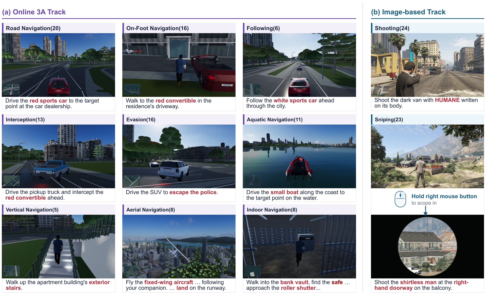
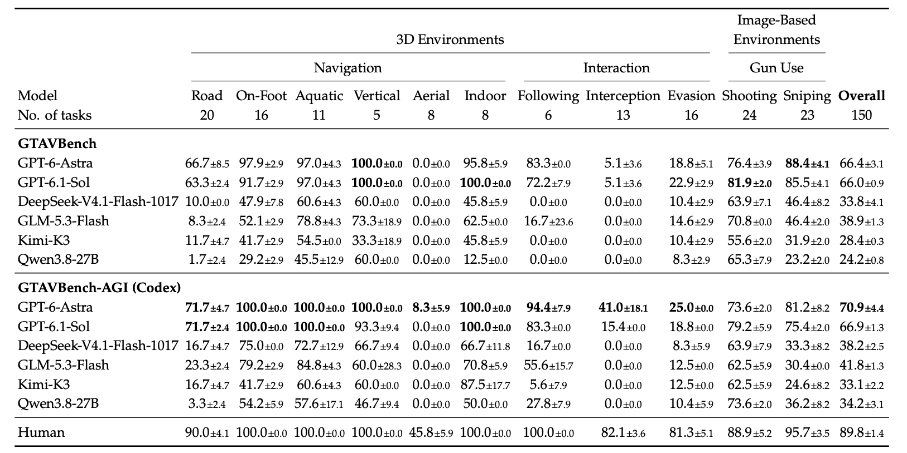
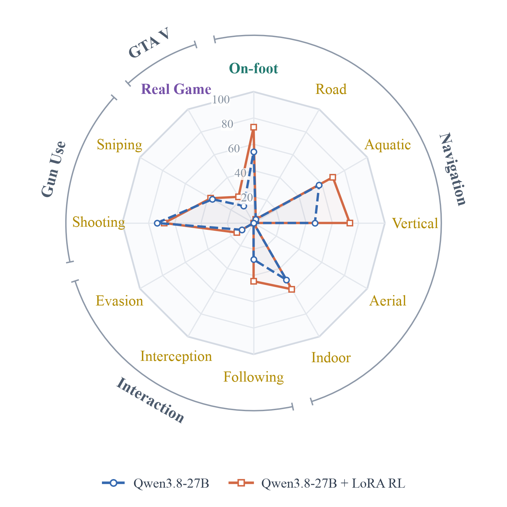

<div align="center">

# GTAGym

**AAA Game Tasks Environment for Evaluation and Reinforcement Learning**

<p>
  <a href="https://arxiv.org/abs/2611.13028"></a>
  <a href="https://huggingface.co/datasets/OpenMOSS-Team/GTAVBench"></a>
  <a href="https://ljbro.github.io/GTAGym/tasks.html"></a>
  <a href="https://github.com/ljbro/GTAGym"></a>
</p>

[Paper](https://arxiv.org/abs/2611.13028) · [Dataset](https://huggingface.co/datasets/OpenMOSS-Team/GTAVBench) · [Play Online](https://ljbro.github.io/GTAGym/tasks.html) · [Main Results](#main-results) · [Reinforcement Learning](#reinforcement-learning) · [Quick Start](#quick-start)

</div>

<p align="center"><strong>Play in your browser:</strong> <a href="https://ljbro.github.io/GTAGym/tasks.html">Browse all 150 tasks</a> · <a href="https://ljbro.github.io/GTAGym/?task=c02-n15">Try C02-N15</a>. No installation required.</p>

<p align="center">
  <a href="docs/images/task-overview.png"></a>
</p>

<p align="center"><sub><strong>150 tasks across 11 categories:</strong> 103 interactive 3D tasks and 47 image-based shooting and sniping tasks, derived from GTA V main-story missions.</sub></p>

GTAGym provides game environments, automatic outcome checks, and a shared screenshot–keyboard–mouse interface for evaluating and training agents on GTA V tasks. Its browser-based 3D environment is built with Babylon.js on top of [GTA_SZ](https://github.com/linranff/GTA_SZ). Game code, task definitions, rendering assets, and evaluation runners are included in this repository.

- **Two evaluation protocols.** GTAVBench gives models textual instructions and accepts JSON actions. GTAVBench-AGI places the instruction in the first screenshot and uses the Codex harness with only `game_step` available to the agent.
- **Automatic evaluation and complete trajectories.** Engine state determines task outcomes. Evaluation records screenshots, actions, compressed videos, token usage, and provider-returned reasoning or reasoning summaries.
- **Task generation for RL.** Configurable templates cover all nine 3D categories and image-based shooting, with route, movement, target-relation, landmark, and timing parameters. The release also includes 50 on-foot training tasks, separate from the benchmark.

## Main Results

Task-level accuracy (%) from the paper. Entries show **mean ± population standard deviation** over three seeds; the human baseline averages three participants. Overall accuracy is weighted by the number of tasks. Bold marks the best nonzero model score in each column across both protocols.

<p align="center">
  <a href="docs/images/main-results.jpg"></a>
</p>

The best configuration reaches **70.9%** overall accuracy, compared with **89.8%** for the human baseline. Aerial navigation, interception, and evasion remain difficult even for the strongest models.

## Reinforcement Learning

We train **Qwen3.8-27B with rank-32 LoRA and GRPO** inside the Codex harness on generated on-foot navigation tasks. Training uses automatic success and distance-progress rewards, with a deduction for trajectories exceeding 100 rounds.

<p align="center">
  <a href="docs/images/rl-transfer.png"></a>
</p>

<p align="center"><sub>Green: in-domain on-foot navigation. Yellow: out-of-domain benchmark categories. Purple: native GTA V tasks. Blue dashed curve: base model; orange solid curve: RL-trained model.</sub></p>

| Evaluation | Base Qwen3.8-27B | + LoRA RL |
| :--- | ---: | ---: |
| On-foot navigation — held-out ID tasks | 54.2% | **72.9%** |
| Ten OOD benchmark categories | 31.8% | **34.8%** |
| All 150 benchmark tasks | 34.2% | **38.9%** |
| 100 native GTA V tasks | 15.0% | **23.0%** |

Benchmark values are three-seed means under the Codex protocol. Native GTA V results use video-based human verification. See the [paper](https://arxiv.org/abs/2611.13028) for training details and analysis, and [training-tasks/](training-tasks/) for the released on-foot dataset and generation configuration.

## Dataset and Documentation

The [Hugging Face dataset](https://huggingface.co/datasets/OpenMOSS-Team/GTAVBench) contains all 150 test tasks as Parquet, with seven fields: `id`, `category`, `instruction`, `initial_observation`, `environment_type`, `movement`, and `play_url`. Each `play_url` opens that task in the browser. Initial observations are embedded images at 1280 × 720. The runnable environments and evaluation code are provided here on GitHub.

| Resource | Contents |
| :--- | :--- |
| [Play online](https://ljbro.github.io/GTAGym/tasks.html) · [All task links](docs/task-links.md) | Open any benchmark task directly in a desktop browser |
| [Task catalog](tasks/) · [Task identifiers](docs/task-identifiers.md) | Frozen test tasks, instructions, and `cXX-nYY` category/task IDs |
| [Evaluation guide](docs/evaluation.md) | Provider configuration, prompts, actions, recordings, and recovery |
| [Task generation](docs/generation.md) | YAML parameters, controller validation, generation, and replay |
| [Training tasks](training-tasks/) | The retained 50-task on-foot dataset and sampling configuration |
| [Validation](docs/validation.md) | Release, evaluator, and browser checks |

## Acknowledgements

**Our primary acknowledgement goes to [GTA_SZ](https://github.com/linranff/GTA_SZ), created by linranff and its contributors.** Their city environment and game systems form the foundation of GTAGym's 3D environments. We also acknowledge Rockstar Games for GTA V gameplay imagery and the authors of the assets and software used in this project.

Full credits are in [ACKNOWLEDGEMENTS.md](ACKNOWLEDGEMENTS.md). Asset-specific licenses and provenance remain in [licenses/](licenses/) and alongside the assets; the inherited game code retains its [MIT license](native-city/LICENSE).

## Citation

```bibtex
@misc{chen2026gtagym,
  title         = {GTAGym: AAA Game Tasks Environment for Evaluation and Reinforcement Learning},
  author        = {Jiajun Chen and Shicheng Fang and Jiahao Lu and Yuxin Wang and Xipeng Qiu},
  year          = {2026},
  eprint        = {2611.13028},
  archivePrefix = {arXiv},
  url           = {https://arxiv.org/abs/2611.13028}
}
```

## Quick Start

**Try without installing:** open the [online task directory](https://ljbro.github.io/GTAGym/tasks.html), select a task, and press **Start task**. The game renders on your device; the task clock starts after loading, when you press Start. See [online-play.md](docs/online-play.md) for hosting details.

### 1. Install and play

Requirements: **Linux, Node.js 22.18+, Python 3, FFmpeg with `libx264`, and Chromium's Linux dependencies**. Automated GPU evaluation also needs a working graphics driver. Evaluation browsers and video encoding run on the machine hosting the evaluator.

```bash
git clone https://github.com/ljbro/GTAGym.git
cd GTAGym
npm ci
npx playwright install --with-deps chromium
npm run build
npm start -- --port 4200
```

Open **http://127.0.0.1:4200/**, choose a category and task, and start playing. Keep the server running for evaluation. Assets and task data are served from this checkout. Use `npm run dev` for development.

### 2. Evaluate a model with JSON actions

In another terminal, create a local configuration:

```bash
mkdir -p configs/local
cp configs/json.example.json configs/local/my-model.json
```

Edit `baseURL`, `model`, `api`, and `effort` for your model service. Set `tasks` to `"all"` for the full benchmark, `"online"` for the 103 3D tasks, or an array such as `["c02-n01"]` for a smoke run. `workers` controls concurrency; the example uses four workers.

```bash
export GTA_AGENT_API_KEY='YOUR_API_KEY'
npm run eval:json -- --config configs/local/my-model.json --dry-run
npm run eval:json -- --config configs/local/my-model.json
```

`--dry-run` checks configuration without opening a browser or making a model call. Credentials stay in the environment or an external key file. Configuration paths resolve from the repository root.

### 3. Evaluate with the Codex harness

Install the Codex CLI separately and make sure `codex` is available on `PATH`. The integration was checked with `codex-cli 0.164.0`.

```bash
cp configs/codex.example.json configs/local/my-codex.json
```

Configure the provider and task selection as above, then run:

```bash
codex --version
npm run eval:codex -- --config configs/local/my-codex.json --dry-run
npm run eval:codex -- --config configs/local/my-codex.json
```

The evaluated agent receives Codex's native context, the shared game rules in `AGENTS.md`, and an initial screenshot containing the task instruction. Only `mcp__game__game_step` is exposed. Codex manages its own interaction history. See [evaluation.md](docs/evaluation.md) for protocol details, model configuration, and resume behavior.

Results go to the configuration's `output` directory under `.cache/server-eval/` by default. Compressed archives preserve the complete trajectory even when model context is pruned. Videos use MP4; token usage and provider-returned reasoning are saved alongside the run.

### 4. Generate training tasks

With the game server still running:

```bash
python3 -m pip install -r requirements-generation.txt
npm run generate -- matrix
npm run generate -- plan --spec configs/generation/online.yaml
npm run generate -- generate --spec configs/generation/online.yaml \
  --url http://127.0.0.1:4200/ --renderer gpu --output outputs/online-sample
```

The example spans all nine 3D categories and seven movement modes. Generated tasks are controller-validated and stored separately from the frozen test catalog. Open **http://127.0.0.1:4200/?trainingDataset=online-sample.json** to play them. Image-based shooting generation requires an imported annotated image pool; sniping is evaluation-only. Full configuration and validation details are in [generation.md](docs/generation.md).
